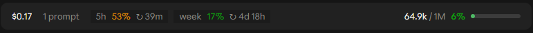

# usage-band

A Claude Code mod: a band above the prompt showing session usage: the cost, prompt count and rate
limits on the left, the context gauge on the right. Based on the token-weather sample in anthropics/claude-code-playground.
Needs Claude Code 2.1.287 or later.



- **Context fill**: a meter and percentage (a rounded bar on desktop, a line in the terminal), coloured
  by the theme: success below 50%, warning from 50%, Claude orange from 75%, error from 90%.
- **Context**: tokens in the live context window against the window size.
- **Cost**: the session's cost so far, as `/cost` totals it (an estimate at API prices), where Claude
  Code reports one.
- **Prompts**: how many prompts you have sent this session, counted from the transcript.
- **Rate limits**: each window the account reports (5-hour, weekly, a gateway's spend limit) in a
  pill showing the share used and the time until it resets, as the Usage panel shows them. Absent
  off a subscription. The share updates with each response from the model; the countdown every minute.

On desktop the rate-limit pills have a slightly darker, recessed background; the rest is plain text.

Under 80 columns the band drops the prompt count.

The band reads usage as soon as the session starts, showing an animated placeholder until the first
figures arrive (it gives up after 30 seconds without any). It refreshes when a turn finishes and steps
aside while a survey is shown.

```
/plugin marketplace add QuantiCZ/claude-code-mods
/plugin install usage-band@quanti-mods
```

## Develop

```bash
claude plugin validate plugins/usage-band
claude plugin test plugins/usage-band
```
